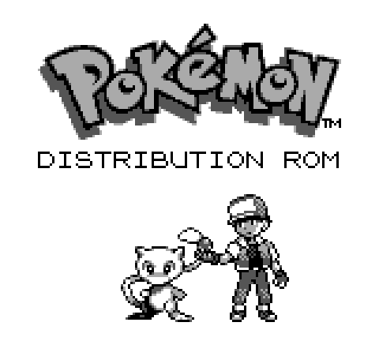
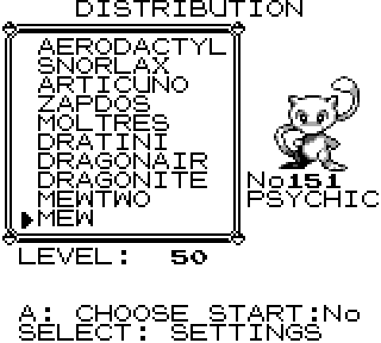
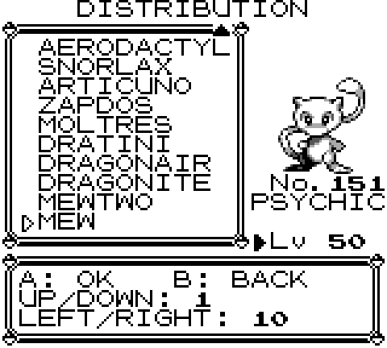
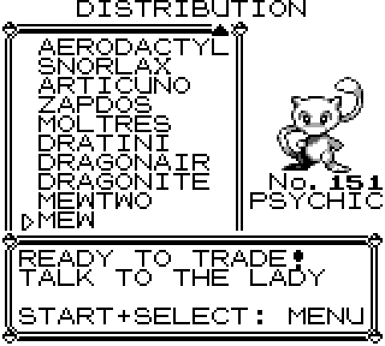
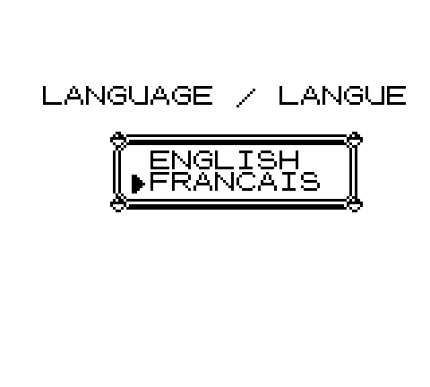

# Pokémon Distribution ROM [![Build Status][ci-badge]][ci]

An event-distribution cart built from the French Pokémon Rouge and Bleue, in
French or English. It boots into a menu. You pick any of the 151 Pokémon and a
level, then trade that Pokémon to a real cartridge over a link cable.

<p align="center">
  
  
  <br>
  
  
</p>

## How it works

This is a fork of the French pokered disassembly. The other Game Boy runs a
retail cartridge, so the link protocol has to match it byte for byte. The menu
builds a one-Pokémon party in WRAM and then hands off to the game's own Cable
Club code, which is unchanged.

The gift is a valid Pokémon. It has the right stats for its level, a level-up
moveset, random DVs, the species name as its nickname, and your name plus a
random ID as its OT.

## Language

The screen after the title picks French or English. English switches the menu,
the Pokémon names and all of the game's own text: the receptionist, the trade
screens, the START menu and the dialogue. The gift is named in the chosen
language too, so pick English for an English cartridge and it arrives as `MEW`,
not as its French name.

<p align="center">
  
</p>

The English text is pret/pokered's, converted by
[`tools/make_english_text.py`](tools/make_english_text.py). The French text
banks and the English ones share their labels, so the engine swaps each French
text for its English twin when it prints it. Still French in English mode: the
battle menus, the bag and item names, and the Pokédex.

## Controls

**Pokémon list**

| Button | Action |
| --- | --- |
| Up / Down | Move one entry. Hold to repeat. Wraps, so Mew is one press up from Bulbasaur |
| Left / Right | Page by 10 |
| Start | Jump to a Pokédex number |
| Select | Settings |
| A | Choose this Pokémon |

**Level**

| Button | Action |
| --- | --- |
| Up / Down | ±1 |
| Left / Right | ±10 |
| A | Confirm |
| B | Back to the list |

**Anywhere**

| Button | Action |
| --- | --- |
| Start + Select, held half a second | Back to the menu |

Start + Select resets the cart between visitors, with no power cycle. It does
nothing during a link session, so you cannot drop a trade halfway.

## Settings

Press Select on the list. `NAME:` sets the OT name stamped on every gift. It
defaults to `OneSear` and holds 7 characters. `LANGUAGE:` switches between
English and French. The name, the language and the level are all kept when you press
Start + Select.

## Build

You need [rgbds](https://rgbds.gbdev.io/) 1.0.0 or newer. See
[INSTALL.md](INSTALL.md) for setup.

```sh
make
```

This writes `pokemon_distribution.gb`, 1 MB. A clean rebuild is byte-identical.
The extension is `.gb` because the CGB flag at `$0143` is `$00`. The ROM runs on
a Game Boy, a Super Game Boy and a Game Boy Color.

## Handing out a Pokémon

1. Boot the cart, press Start and pick a language.
2. Press Select if you want to change the OT name.
3. Pick a Pokémon with A, set the level, press A again.
4. Press A once more. You are now in a Pokémon Center, in front of the link
   receptionist.
5. Connect the two Game Boys. Send the other player to any Cable Club, then
   talk to the receptionist on both ends and trade.
6. Press Start + Select for the next visitor.

The cart trades its only Pokémon away, so step 6 builds a fresh one.

## What was changed

| File | |
| --- | --- |
| `engine/menus/distribution.asm` | the menu, sprite preview, settings, language screen and party builder |
| `text_en/`, `text_en.asm` | English text and Pokémon and move names, generated from pret/pokered |
| `engine/menus/distribution_text_lookup.asm` | finds the English twin of a French text |
| `home/text.asm`, `home/names.asm`, `home/names2.asm` | language hooks for far text, Pokémon names and move names |
| Cable Club, trade, menu and status screen files | each menu string followed by its English version |
| `gfx/distribution_banner.asm` | the "DISTRIBUTION ROM" banner |
| `engine/movie/title.asm` | new banner, Mew on the title, Start opens the menu |
| `home/init.asm` | skips the intro battle |
| `engine/joypad.asm` | the Start + Select hook |
| `main.asm`, `layout.link`, `ram/wram.asm` | bank `$2D` and its WRAM; `print_type.asm` moved out of the full bank `$09` |
| `Makefile` | one target instead of four |

The Cable Club and trade logic, the link protocol and the sprites are untouched.
In French the game's own text is exactly what it was before.

## Status

Tested in PyBoy on DMG and CGB: all 151 list entries and preview sprites, the
scrolling and paging, the party bytes against the Gen 1 stat formula, and the
Start + Select return. Both languages tested through the receptionist, the
START menu, the save prompt and the STATS screen.

The link trade itself is untested. That needs two SameBoy instances or real
hardware.

Screenshots come from [`docs/capture_screenshots.py`](docs/capture_screenshots.py),
which drives the SameBoy libretro core. Run it after `make` to redo them.

## Credits

Built on [pret/pokered][pokered] and the French fork
[einstein95/pokered-fr][pokered-fr]. The English text comes from pret/pokered.

Pokémon is a trademark of Nintendo, Creatures and GAME FREAK. This repository
holds no game data. You build the ROM from source yourself.

[pokered]: https://github.com/pret/pokered
[pokered-fr]: https://github.com/einstein95/pokered-fr
[ci]: https://github.com/OneSear/pokemon-distribution-rom/actions
[ci-badge]: https://github.com/OneSear/pokemon-distribution-rom/actions/workflows/main.yml/badge.svg
